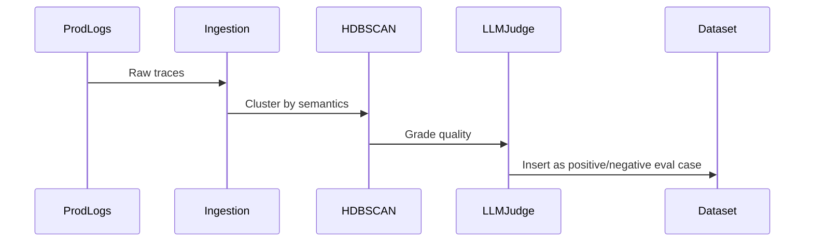

# Architecture: Automated Eval Dataset Generator

## System Diagram
The following Mermaid.js sequence diagram maps the core workflow and interactions:

## Component Breakdown
- **Core Technology**: Python, scikit-learn, HDBSCAN, ClickHouse
- **Design Paradigm**: Emphasizes high availability, fault tolerance, and security.
